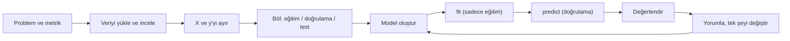

# Online Alışveriş Sitelerinde Ziyaretçinin Satın Alma Niyetinin Tahmini

> Bir e-ticaret sitesine giren ziyaretçinin oturumu **alışverişle bitecek mi?**
> Bu projede bu soruyu, ziyaretçinin sitede gezinme davranışından makine öğrenmesiyle tahmin ediyoruz.


**Ders:** Makine Öğrenmesine Giriş, dönem projesi (2026)

## Proje ekibi
| | |
|---|---|
| **İsmail Kayaalp** | [@kayaalpismail1221-glitch](https://github.com/kayaalpismail1221-glitch) |
| **Ahmet Sadri Akıllı** | |

---

## Proje nedir?
İnsanlar bir alışveriş sitesine girer, ürün sayfalarını gezer, bazı sayfalarda uzun süre kalır. Bazıları ödeme yapar, çoğu ise hiçbir şey almadan çıkar. Bu proje, bir oturumun **alışverişle bitip bitmeyeceğini** o oturumdaki davranışa bakarak tahmin eden bir model geliştiriyor:

- kaç ürün, bilgi ve hesap sayfası gezildiği ve bu sayfalarda ne kadar kalındığı,
- sayfaların hemen çıkma (bounce) ve çıkış (exit) oranları,
- ziyaretin ayı, özel günlere yakınlığı, hafta sonu olup olmadığı,
- ziyaretçinin yeni mi yoksa geri dönen bir ziyaretçi mi olduğu.

Makine öğrenmesi açısından bu bir **ikili sınıflandırma** problemi. Hedef değişken `Revenue`: 1 = alışveriş yaptı, 0 = yapmadı.

## Ne işe yarar?
Satın alma niyetini önceden tahmin edebilen bir model, e-ticaret sitesine şu konularda yardım eder:

- **Doğru kişiye kampanya:** Alma ihtimali yüksek ama çıkmak üzere olan ziyaretçiye indirim ya da ücretsiz kargo teklifi gösterilebilir. Zaten alacak olana boşuna indirim verilmez.
- **Kaynakları verimli kullanmak:** Canlı destek ve öneri sistemleri, alma ihtimali yüksek oturumlara yönlendirilebilir.
- **Davranışı anlamak:** Hangi gezinme davranışının alışverişle ilişkili olduğunu görmek site tasarımına yol gösterir.

Projenin asıl amacı yalnızca yüksek bir skor almak değil. **Bu skorun gerçek hayatta da geçerli olup olmayacağını dürüstçe sınamak** istiyoruz (bkz. [Özgün katkılarımız](#özgün-katkılarımız)).

---

## Veri
| | |
|---|---|
| **Kaynak** | UCI Machine Learning Repository, [Online Shoppers Purchasing Intention](https://archive.ics.uci.edu/dataset/468) (id = 468) |
| **Boyut** | 12.330 oturum, 17 girdi değişkeni (10 sayısal, 7 kategorik) |
| **Hedef** | `Revenue`: %84,5 alışverişsiz, **%15,5 alışverişli** (dengesiz) |
| **Kapsam** | Bir yıllık dönem, her oturum farklı bir kullanıcıya ait |
| **Lisans** | CC BY 4.0, kişisel bilgi içermez |

Değişkenlerin anlamları, verinin nasıl toplandığı ve sınırlamaları **veri kartında** anlatılıyor: [`data/README.md`](data/README.md).

## Değerlendirme: neden accuracy değil?
Oturumların %84,5'i alışverişsiz bittiği için herkese "almaz" diyen bir model hiçbir şey öğrenmeden **%84,5 accuracy** alır, ama tek bir alıcıyı bile yakalayamaz. Bu yüzden şu metrikleri kullanıyoruz:

| Metrik | Sorduğu soru |
|---|---|
| **PR-AUC** (ana metrik) | Tüm eşiklerde precision–recall dengesi ne kadar iyi? |
| **Precision** | "Alır" dediklerimizin kaçı gerçekten aldı? |
| **Recall** | Gerçek alıcıların kaçını yakaladık? |
| **F1** | Precision ile recall'un dengesi |

Karar eşiği 0,5 kabul edilmiyor. Eşiği **doğrulama setinde** F1'i en yüksek yapacak şekilde seçiyoruz.

## Modeller
| Model | Neden var? |
|---|---|
| **Baseline 1:** herkese "almaz" (`DummyClassifier`) | Alt sınır: hiçbir şey öğrenmeyen model |
| **Baseline 2:** "PageValues > 0 ise alır" kuralı | Alan bilgisine dayalı basit kural; modeller bunu geçmeli |
| **Lojistik Regresyon** | Basit, yorumlanabilir doğrusal model |
| **Karar Ağacı** | Doğrusal olmayan ilişkiler, okunabilir kurallar |
| **Random Forest** | Ağaç topluluğu, genelde en güçlü aday |

Tüm modeller scikit-learn ile kuruluyor; derin öğrenme kullanılmıyor.

## Özgün katkılarımız
**1. PageValues sızıntı deneyi.** Önceki çalışmalarda en güçlü değişken `PageValues` çıkıyor. Ancak Google Analytics'te bir sayfanın "değeri" **alışveriş yapılan oturumlardan** hesaplanıyor. Bu, değişkenin içine hedefin kendisinin sızmış olabileceği anlamına geliyor. Aynı modelleri PageValues ile ve PageValues olmadan eğitip şu soruyu cevaplayacağız: *Model gerçekten davranışı mı öğreniyor, yoksa tek bir şüpheli değişkene mi yaslanıyor?*

**2. Zamana göre bölme.** Rastgele bölmede eğitim ve test aynı aylardan gelir, bu da iyimser bir sonuç verir. Gerçek hayatta model geçmişle eğitilip gelecekte kullanılır. Bu yüzden ayrıca **Şubat–Ağustos ile eğitip, Eylül–Ekim'de doğrulayıp, Kasım–Aralık'ta test** edeceğiz. Böylece modelin zaman içinde ne kadar dayanıklı olduğunu ölçeceğiz.

---

## Nasıl çalışıyoruz?
Her notebook dersteki makine öğrenmesi iş akışını adım adım izler:



Notebook'lardaki her adım dört parçadan oluşuyor:
1. Başlık ve dersteki karşılığı
2. Sözde kod
3. Kısa, yorumlu kod
4. Çıktı ve yorum

`fit()` ve `predict()` hiçbir zaman yardımcı fonksiyonların içine saklanmaz, her zaman notebook'ta açıkça görünür.

**Uyduğumuz kurallar:**
- Test seti yalnızca en sonda, `06_final_test`'te **bir kez** kullanılır. Model seçimi ve ayarı doğrulama setinde yapılır.
- Tekrar eden satırlar **bölmeden önce** silinir.
- Ölçekleme ve one-hot kodlama `Pipeline` içinde, **sadece eğitim verisine** fit edilir.
- `RANDOM_STATE = 42` sabittir ve her deney [`reports/deney_gunlugu.md`](reports/deney_gunlugu.md)'ye kaydedilir.

## İlerleme
| Notebook | Hafta | İçerik | Durum |
|---|---|---|---|
| — | H1–H2 | Literatür, problem tanımı, öneri formu | ✅ |
| [`01_eda`](notebooks/01_eda.ipynb) | H3–H4 | Veri kalitesi, dağılımlar, dengesizlik, aylar, PageValues | 🔄 Adım 0–4 tamam |
| [`02_baseline`](notebooks/02_baseline.ipynb) | H5–H6 | Bölmeler, Pipeline, iki baseline, lojistik regresyon | ⬜ |
| [`03_modeller`](notebooks/03_modeller.ipynb) | H7–H8 | Karar ağacı, Random Forest, 3 modelin karşılaştırılması | ⬜ |
| [`04_deneyler`](notebooks/04_deneyler.ipynb) | H9–H10 | Hiperparametre, eşik, PageValues ve zaman bölmesi deneyleri | ⬜ |
| [`05_hata_analizi`](notebooks/05_hata_analizi.ipynb) | H9–H10 | Yanlış tahminler hangi alt gruplarda toplanıyor? | ⬜ |
| [`06_final_test`](notebooks/06_final_test.ipynb) | H11–H12 | Test setinde tek değerlendirme, sunum | ⬜ |

Haftalık ayrıntı [`reports/haftalik_ilerleme.md`](reports/haftalik_ilerleme.md)'de. Commit geçmişi her adımın ne zaman yapıldığını gösterir.

## Kurulum ve çalıştırma
```bash
python -m venv .venv
# Windows:  .venv\Scripts\activate      macOS/Linux:  source .venv/bin/activate
pip install -r requirements.txt
python scripts/download_data.py    # veriyi data/raw/ altına indirir ve doğrular
jupyter lab
```
Notebook'ları sırayla (01 → 06) açın. Her biri "Restart & Run All" ile baştan sona çalışacak şekilde yazılıyor.

## Klasör yapısı
```
data/        veri kartı; ham veri (repoda yok, betikle indirilir) ve işlenmiş veri
docs/        proje öneri formu, ders kriterlerinin özeti
notebooks/   01–06 arası adım adım notebook'lar
src/         ortak kod: ayarlar, temizleme ve bölme, ön işleme, kural baseline'ı, metrikler
scripts/     veri indirme betiği
reports/     deney günlüğü, haftalık ilerleme, figürler
sunum/       final sunumu
```

## Kaynaklar
- Sakar, C., & Kastro, Y. (2018). *Online Shoppers Purchasing Intention Dataset*. UCI Machine Learning Repository. https://doi.org/10.24432/C5F88Q
- Sakar, C. O., Polat, S. O., Katircioglu, M., & Kastro, Y. (2019). Real-time prediction of online shoppers' purchasing intention using multilayer perceptron and LSTM recurrent neural networks. *Neural Computing and Applications*, 31, 6893–6908. https://doi.org/10.1007/s00521-018-3523-0
- Xiong, L., Chen, X., Liang, J., Cao, X., Zhu, P., & Zhao, M. (2024). Tree-based methods for analytics of online shoppers' purchasing intentions. *International Journal of Data Science*, 9(2), 99–122.

---

<sub>Bu proje İsmail Kayaalp ve Ahmet Sadri Akıllı tarafından Makine Öğrenmesine Giriş dersi için hazırlanmıştır. Veri seti CC BY 4.0 lisansıyla kaynak gösterilerek kullanılmıştır.</sub>
